### 👋 Hi, I'm Mohammad Atash

---

## 🧑‍💻 About Me

**Full-Stack Developer | Frontend-Focused | AI & Intelligent Systems Enthusiast**

I'm a **Full-Stack Developer** with a strong focus on **Frontend Engineering**, passionate about building modern, scalable, and user-centered software applications.

My primary focus is frontend development, while also working across backend engineering, API development, and database management to build complete software solutions.

Beyond software engineering, I'm deeply interested in **Artificial Intelligence**, particularly Machine Learning, Deep Learning, Large Language Models (LLMs), intelligent assistants, AI agents, and AI-powered automation.

I value **clean code**, maintainable architecture, continuous learning, teamwork, and collaborative problem-solving. I'm always eager to explore new technologies, exchange knowledge, and contribute to meaningful projects.

---

## 🛠️ Technical Skills

### 🎨 Frontend Development

- HTML5, CSS3, JavaScript (ES6+), TypeScript
- React.js
- Tailwind CSS, Bootstrap
- Responsive Web Design
- Component-Based Development
- Modern UI Development

### ⚙️ Backend Development

- Node.js, Express.js, NestJS
- RESTful API Design & Development
- API Integration
- Backend Application Architecture
- Authentication & Authorization

### 🗄️ Databases

- MySQL, PostgreSQL, MariaDB
- Microsoft SQL Server
- MongoDB
- SQL & NoSQL Database Technologies
- Database Design & Management

### 💻 Programming Languages

- Python
- JavaScript
- TypeScript
- C++

### 🚀 Software Engineering & DevOps

- Git & GitHub
- Docker & Containerization
- CI/CD Pipelines
- Software Testing & Test Automation
- Unit & Integration Testing
- Application Monitoring & Logging
- Technical & API Documentation
- Clean Code & Modular Architecture

---

## 📌 Featured Projects

---

## 🎯 Areas of Interest

- Artificial Intelligence & Machine Learning
- Deep Learning & Neural Networks
- Large Language Models (LLMs)
- Generative AI & AI Research
- AI-Powered Assistants & Intelligent Agents
- AI Workflow & Process Automation
- Intelligent Systems & Emerging Technologies
- Software Architecture & Scalable Applications

---

## 🚀 Currently Exploring

- Advanced Frontend Engineering
- Modern React Ecosystem & Software Architecture
- Advanced Backend Development with NestJS
- Machine Learning & Deep Learning Applications
- LLM Integration & AI Agent Development
- Intelligent Automation & AI-Powered Workflows
- Advanced Testing & DevOps Practices
- Scalable and Maintainable Software Systems

---

## 💡 Engineering Mindset

- Continuous Learning & Professional Growth
- Teamwork & Collaborative Development
- Clean, Readable & Maintainable Code
- Analytical Thinking & Problem-Solving
- Knowledge Sharing & Technical Collaboration
- Open-Source Contribution
- Software Engineering Best Practices

---

## 📊 GitHub Stats

## 🏆 GitHub Trophies

## 📈 Contribution Activity

## 🐍 Contribution Snake

<picture>
  <source media="(prefers-color-scheme: dark)" srcset="https://raw.githubusercontent.com/MFCAtash/MFCAtash/output/github-contribution-grid-snake-dark.svg">
  <source media="(prefers-color-scheme: light)" srcset="https://raw.githubusercontent.com/MFCAtash/MFCAtash/output/github-contribution-grid-snake.svg">
  
</picture>

---

## 📫 Let's Connect

Always open to meaningful collaborations, technical discussions, new opportunities, and building innovative software solutions.

> **Think creatively. Code cleanly. Build intelligently. Keep evolving.**

